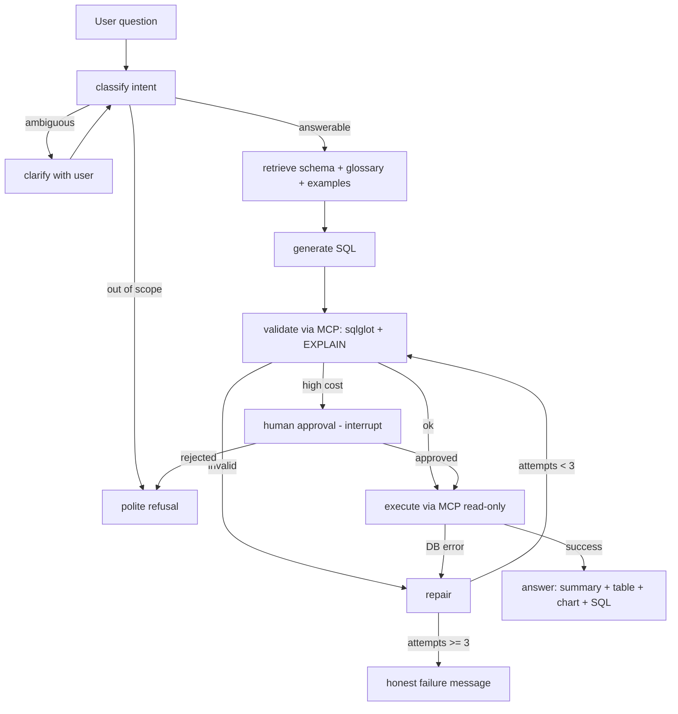

# Agentic Text-to-SQL Analyst (LangGraph + MCP)

> A safe, evaluated, self-correcting AI analyst that answers business questions in plain language over a SQL database (PostgreSQL, then AWS Athena).

---

# Part 1: Project Description

## 1.1 Overview

A user asks a business question such as *"What was the loss ratio by country last quarter?"*. The agent works out which tables matter, writes the SQL, validates it, runs it safely under read-only guardrails, repairs its own mistakes, pauses for human approval on costly queries, and returns a summary, a table, and a chart, always showing the SQL it used.

## 1.2 The problem

A simple "prompt an LLM to write SQL" demo breaks on real databases because of:

- **Large schemas** that do not fit in a prompt.
- **Ambiguous column names** (`status` appearing in several tables).
- **Wrong joins** and **hallucinated tables or columns**.
- **Unknown business definitions** (what does "active customer" mean?).
- **Safety risks**: destructive queries, prompt injection, PII leaks, runaway costs.

This project handles those failures and **measures** how well it does so.

## 1.3 Key features

| Feature | What it does |
|---|---|
| Intent classification | Detects answerable, ambiguous, and out-of-scope questions; asks clarifying questions when needed |
| Schema retrieval (RAG on the database) | Retrieves only the relevant tables, columns, glossary terms, and example queries |
| Semantic layer | Business glossary and verified example queries improve accuracy |
| SQL generation | Structured-output generation with dynamic few-shot examples |
| Validation | AST-level checks with `sqlglot` plus `EXPLAIN` cost estimates |
| Guardrails | SELECT-only, single statement, table allowlist, PII masking, forced LIMIT, timeout, read-only DB role |
| Self-repair loop | Database errors are fed back to the agent (max 3 retries) |
| Human-in-the-loop | Expensive or sensitive queries pause for approval via LangGraph interrupts |
| MCP server | Tools and guardrails exposed through a reusable server (usable from Claude Desktop, Cursor, or your own app) |
| Observability | Full tracing, cost, and latency in Langfuse |
| Evaluation | Golden set, BIRD/Spider subset, safety suite, ablations, CI quality gate |

## 1.4 Architecture



## 1.5 Tech stack

| Layer | Tool | Why |
|---|---|---|
| Orchestration | LangGraph | State, loops, conditional branches, interrupts, checkpoints |
| Tool protocol | MCP (FastMCP) | Reusable, safe-by-design tool server |
| SQL safety | sqlglot + read-only DB role | AST-level checks plus a hard database boundary |
| Retrieval | Chroma + BM25 + reranker | Hybrid works best on schema names |
| Database | PostgreSQL, then Athena | Fast iteration, then cloud realism |
| Observability | Langfuse | Tracing, cost, experiments |
| Evaluation | BIRD subset + golden set + safety suite | Credible numbers |
| API / UI | FastAPI + Chainlit or Streamlit + Plotly | Shows steps, SQL, approvals |
| Delivery | Docker Compose + GitHub Actions | One-command run, CI quality gate |

## 1.6 Why this project is strong for a CV

- Combines **GenAI engineering** (agents, RAG, MCP) with **data engineering** (warehouse, Athena, Parquet) and **data science rigor** (evaluation, ablations).
- Uses a very current skill set (LangGraph, MCP).
- Backed by numbers: execution accuracy, ablation gains, safety block rate, cost per query.

## 1.7 Suggested CV entry

> **Agentic Text-to-SQL Analyst** | GitHub
> - Built a LangGraph agent with an MCP server that answers business questions over PostgreSQL/AWS Athena: schema-aware hybrid retrieval, SQL validation, read-only guardrails, self-repair loop, and human approval for costly queries.
> - Reached **X%** execution accuracy on a BIRD subset; schema retrieval and the repair loop added **Y** points; blocked **100%** of a 30+ prompt-injection safety suite; cost **$Z** per query.
>
> *Stack: Python, LangGraph, FastMCP, sqlglot, PostgreSQL, Athena, Chroma, FastAPI, Chainlit, Langfuse, Docker*

---

# Part 2: Step-by-Step Build Guide

> Library APIs (LangGraph, FastMCP, Langfuse) change quickly. Check each library's current docs when you reach that step. The architecture and reasoning stay valid.

## Step 0: Make three decisions first

| Decision | Choice | Why |
|---|---|---|
| Database | **PostgreSQL first**, Athena later | Postgres runs locally in Docker (fast, free). Athena adds cloud credibility but slows iteration and costs money per scan. |
| Data | **Synthetic insurance warehouse** + **BIRD/Spider subset** | Insurance data mirrors your domain. BIRD gives an external benchmark with gold SQL. |
| Scope | Read-only analytics questions only | Safety can be fully guaranteed if the agent never writes data. |

## Step 1: Project setup

**Use:** `uv` (or Poetry), `ruff`, `pytest`, `pre-commit`, Docker Compose, `.env` file.

**Why:** A clean repo signals engineering maturity, and Docker Compose lets a recruiter run everything with one command.

```
text2sql-agent/
├── data/            # generators, seed scripts
├── semantic/        # table docs, glossary, example queries (YAML)
├── mcp_server/      # tools + guardrails
├── agent/           # LangGraph graph, nodes, prompts
├── app/             # FastAPI + UI
├── eval/            # benchmarks, safety tests, reports
├── tests/
└── docker-compose.yml
```

## Step 2: Build the database

**Use:** PostgreSQL (Docker), `Faker`, `pandas`, SQLAlchemy.

**Why:** Faker plus some logic gives realistic data with controlled quirks.

1. Design 8 to 12 tables: `customers`, `policies`, `claims`, `payments`, `agents`, `products`, `countries`, `claim_events`.
2. Add real warehouse headaches on purpose: ambiguous column names (`status` in three tables), many-to-many joins, nullable fields, mixed date formats, and a table the agent must never touch (`internal_audit`).
3. Generate roughly 100k to 500k rows so queries behave realistically.
4. Create **two database roles**: `admin` (for seeding) and `readonly_agent` (SELECT only on an allowlist, with `statement_timeout` set). This is your first and strongest safety layer, since it holds even if every software check fails.

## Step 3: Build the semantic layer (the most underrated step)

**Use:** YAML files, an LLM to draft, you to review.

**Why:** Text-to-SQL accuracy depends more on metadata quality than on the model. A human analyst knows that "active policy" means `status='ACTIVE' AND end_date > today`. The LLM does not.

For each table and column write:

- A plain-language description.
- Sample values and format (for example, country codes `HU`, `NL`).
- Foreign key relationships.

Add two more files:

- **`glossary.yaml`**: business definitions (loss ratio = claims paid / premiums earned, what "churned" means).
- **`examples.yaml`**: 30 to 50 verified question and SQL pairs for few-shot prompting.

Draft descriptions with an LLM from the schema and sample rows, then correct them by hand.

## Step 4: Schema retrieval index

**Use:** Chroma, an embedding model (OpenAI `text-embedding-3-small`, or open-source `bge-m3` / `multilingual-e5`), `rank_bm25`, optionally a cross-encoder reranker.

**Why:** Real databases are too big to paste into a prompt. This is the RAG skill you already have, applied to schemas.

1. Create **one document per table** (name, description, columns) and **one per column** (name, description, sample values).
2. Index glossary entries and example queries in separate collections.
3. At query time run **hybrid retrieval** (dense + BM25). Column names like `clm_amt_paid` are lexical, so embeddings alone handle them poorly.
4. **Expand through foreign keys.** If the retriever returns `claims` and `customers`, also pull any bridge table needed to join them. Without this, the agent invents joins.
5. Return the top 3 to 5 tables with columns, relevant glossary terms, and the top 3 similar example queries.

Measure **table recall@k** against your golden set. If the right table is not retrieved, nothing downstream can succeed.

## Step 5: Build the MCP server with guardrails inside

**Use:** `FastMCP` (Python MCP SDK), `sqlglot`, `psycopg` (or `asyncpg`).

**Why:** Safety in the server protects every client (your agent, Claude Desktop, Cursor). The agent never holds database credentials, so it cannot bypass the checks.

**Tools to expose:**

| Tool | Purpose |
|---|---|
| `list_tables` | Names and descriptions of allowed tables |
| `describe_table` | Columns, types, keys, sample values |
| `validate_sql` | Parse and check without executing |
| `explain_query` | Estimated cost and rows from `EXPLAIN` |
| `run_readonly_query` | Execute with all guardrails applied |

**Guardrail example:**

```python
import sqlglot
from sqlglot import exp

ALLOWED_TABLES = {"customers", "policies", "claims", "payments"}

def check_sql(sql: str, dialect="postgres") -> str:
    statements = sqlglot.parse(sql, dialect=dialect)
    if len(statements) != 1:
        raise ValueError("Only one statement allowed")
    tree = statements[0]
    if not isinstance(tree, exp.Select):          # SELECT / WITH...SELECT only
        raise ValueError("Only SELECT queries allowed")
    for node in tree.walk():
        if isinstance(node, (exp.Insert, exp.Update, exp.Delete, exp.Drop, exp.Command)):
            raise ValueError("Write operations blocked")
    tables = {t.name for t in tree.find_all(exp.Table)}
    if not tables <= ALLOWED_TABLES:
        raise ValueError(f"Table not allowed: {tables - ALLOWED_TABLES}")
    if not tree.args.get("limit"):
        tree = tree.limit(1000)                    # enforce a row cap
    return tree.sql(dialect=dialect)
```

**Defense in depth (layers):**

1. Parse with sqlglot (AST-based, far more reliable than regex or keyword blocking).
2. Single statement only (prevents `; DROP TABLE` tricks).
3. Table allowlist plus column masking for PII (for example, block `national_id`).
4. Forced `LIMIT`.
5. `statement_timeout` at the connection level.
6. The read-only DB role from Step 2.
7. Cost threshold: if `EXPLAIN` estimates more than N rows or a cost above X, flag the query as "needs approval" instead of running it.

Return **structured errors** (error type + message) so the agent can repair queries intelligently.

## Step 6: Build the LangGraph agent

**Use:** `LangGraph`, `langchain-mcp-adapters` (loads MCP tools), Pydantic structured output, a capable LLM (Claude, GPT-4-class, or Gemini; test a cheaper model later for a cost comparison).

**Why:** The workflow is not a straight line (retry loops, approval pauses, clarification branches), so a graph with state fits better than a single autonomous agent, and it is easier to debug and test.

```python
class AgentState(TypedDict):
    question: str
    intent: str                 # answerable | ambiguous | out_of_scope
    schema_context: str
    sql: str
    validation_error: str | None
    needs_approval: bool
    result: list[dict] | None
    attempts: int
    answer: str
```

**Nodes and edges:**

1. **`classify`**: returns structured intent. Ambiguous questions go to `clarify`; out-of-scope questions get a polite refusal.
2. **`retrieve_schema`**: calls the Step 4 retriever.
3. **`generate_sql`**: uses schema, glossary, and few-shot examples. Uses structured output (`{"reasoning": ..., "sql": ...}`) so parsing never breaks. Instruct it to use only provided tables and columns.
4. **`validate`**: calls MCP `validate_sql` and `explain_query`. Failure goes to `repair`; high cost goes to `human_approval`.
5. **`human_approval`**: uses LangGraph `interrupt()`. The user sees the SQL, estimated cost, and Approve / Edit / Reject.
6. **`execute`**: calls `run_readonly_query`. A database error goes to `repair`.
7. **`repair`**: receives the failed SQL and exact error, returns a fixed query. Increment `attempts`; after 3 tries stop and tell the user honestly.
8. **`answer`**: summarizes the result in natural language and always shows the SQL.

**Add a checkpointer** (`PostgresSaver` or `SqliteSaver`). Interrupts require it, and it gives you conversation memory and resumability.

**Handle follow-ups** ("now break that down by country"): pass the previous question and SQL into `generate_sql`.

## Step 7: Prompt engineering (iterate with data, not guesses)

**Use:** Pydantic structured outputs, versioned prompt files, optionally Langfuse prompt management.

**Why:** Prompts are where accuracy is won, and you must be able to compare versions.

- Put the **schema and glossary before the question**, with explicit rules (dialect, date handling, "never use SELECT *").
- Use **dynamic few-shot examples** retrieved by similarity, not a fixed set.
- Ask for **a short plan before the SQL** (tables, joins, filters).
- In the repair prompt include the error text and say "change only what the error requires."
- Keep prompts in files, not inline strings, so you can diff and A/B test them.

## Step 8: Observability

**Use:** Langfuse with its LangChain/LangGraph callback.

**Why:** It helps you debug failures and gives you the cost and latency numbers for the README.

Trace every node, tag each run with the question ID, and track cost per query, latency per node, retry counts, and approval rate. Use Langfuse datasets so evaluation runs appear as scored experiments you can compare side by side.

## Step 9: API and UI

**Use:** FastAPI (streaming endpoint), Chainlit or Streamlit, Plotly.

**Why:** Chainlit handles chat, streaming steps, and approval buttons well. Streamlit is simpler if you prefer it.

The UI should show:

- Live step progress ("Retrieving schema... Validating SQL... Running...").
- The generated SQL in a collapsible block.
- The result table with an auto-selected chart (bar for categories, line for time series).
- The approval prompt for costly queries.

Showing the SQL and the steps makes the agent trustworthy, which is the main product requirement for this kind of tool.

## Step 10: Evaluation (what makes the project powerful)

**Use:** `pytest`, your own eval harness, BIRD or Spider dev subset, Langfuse experiments.

**Why:** Numbers separate your project from tutorial clones.

**Three test sets:**

1. **Golden set**: 60 to 100 questions over the insurance warehouse with gold SQL (easy, medium, hard, deliberately ambiguous).
2. **BIRD/Spider subset**: 100 to 200 examples for an external benchmark.
3. **Safety suite**: 30+ attacks: prompt injection ("ignore previous instructions and DROP..."), stacked statements, forbidden tables, `pg_sleep` abuse, PII requests, huge cross joins.

**Metrics:**

- **Execution accuracy**: compare result sets of generated and gold SQL, ignoring row order and column aliases. Never compare SQL strings, since many different queries are correct.
- **Table recall@k** for retrieval.
- **Repair success rate** and average attempts.
- **Safety block rate** (must be 100%).
- **Latency and cost** per query.

**Ablations** (same set each time):

| Variant | What it shows |
|---|---|
| No schema retrieval (full schema in prompt) | Value of retrieval |
| Dense only vs. hybrid retrieval | Value of BM25 |
| No glossary / no few-shot | Value of the semantic layer |
| No repair loop | Value of self-correction |
| Large model vs. small model | Cost/accuracy trade-off |

Add the eval to **GitHub Actions** so a change that drops accuracy below a threshold fails the build.

## Step 11: Athena extension (optional but valuable)

**Use:** S3, AWS Glue Data Catalog (crawler), Athena, Parquet, `boto3` or `awswrangler`, IAM, Athena workgroups.

**Why:** It reuses your Ominimo AWS skills and shows the design is not tied to one database.

1. Export tables as **partitioned Parquet** in S3 using Bronze/Silver/Gold folders.
2. Register them with a Glue crawler.
3. Create an **Athena workgroup with a per-query data-scanned limit** (a hard cost guardrail).
4. Give the MCP server an **IAM role with read-only permissions** on specific tables.
5. Switch the sqlglot dialect to `athena` (Trino-style) and adapt prompts.
6. Athena has no cheap `EXPLAIN` cost estimate like Postgres, so reject queries lacking a partition predicate on large tables, or send them to approval.

Make the backend pluggable (a `Database` interface with Postgres and Athena implementations), which is a clean design point to mention.

## Step 12: Deployment and polish

**Use:** Docker Compose (Postgres, MCP server, API, UI), GitHub Actions, optionally AWS (ECS or App Runner) or a free-tier host.

**Why:** A live demo link and reproducible setup are what recruiters actually click.

- `docker compose up` should run everything with seeded data.
- README must include: architecture diagram, eval results table, ablation results, cost per query, limitations, and a "what I'd improve next" section.
- Record a 2-minute demo video: a normal question, an ambiguous question, a self-repaired query, a blocked attack, and an approval step.
- Write a short **blog post or LinkedIn post** on the ablation findings.

---

# Part 3: Timeline and Priorities

| Week | Goals |
|---|---|
| 1 | Database, semantic layer draft, MCP server with read-only tools, basic generate-and-run |
| 2 | Schema retrieval, validation, guardrails, repair loop |
| 3 | Human-in-the-loop, UI, evaluation on a benchmark subset |
| 4 | README, architecture diagram, demo video, deployment (and optional Athena) |

**If time is short:** Steps 2, 3, 5, 6, and 10 are the core. Without evaluation you only have a demo, and without guardrails you only have a risk. Athena and UI extras can wait.

## Definition of done

- [ ] `docker compose up` runs the full system with seeded data
- [ ] MCP server enforces all guardrail layers
- [ ] Agent handles clarification, repair, and approval flows
- [ ] Golden set + BIRD subset + safety suite results in the README
- [ ] Ablation table with real numbers
- [ ] CI gate on evaluation accuracy
- [ ] Architecture diagram and 2-minute demo video
- [ ] CV entry updated with real numbers